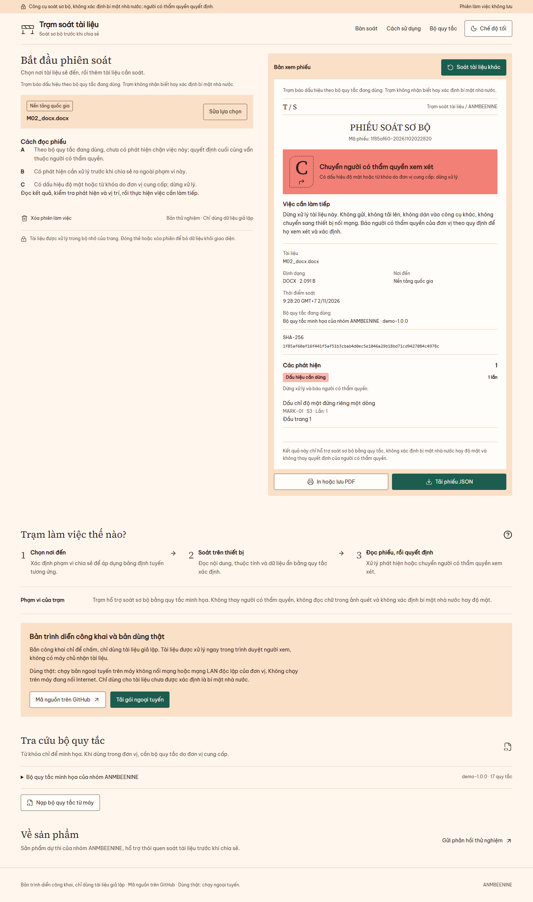

# Trạm soát tài liệu

Web tĩnh hỗ trợ soát sơ bộ một tài liệu trước khi chia sẻ, xử lý ngay trong trình duyệt.

[Bản trình diễn](https://tram-soat-tai-lieu.vercel.app) · [Mã nguồn](https://github.com/CrisPham06/tram-soat-tai-lieu)




## Trạm làm gì

- Đọc nội dung và một số dữ liệu ẩn trong DOCX, PDF có lớp chữ, TXT, XLSX và PPTX.
- Báo dấu hiệu theo bộ quy tắc, định tuyến theo nơi đến và tạo phiếu để đọc, in hoặc tải JSON.
- Che các đoạn khớp trong chế độ dán; gặp dấu hiệu độ mật thì dừng và khóa sao chép.

## Phạm vi và giới hạn

Trạm chỉ soát sơ bộ bằng quy tắc xác định, không nhận biết hay xác định bí mật nhà nước hoặc độ mật.
Quyết định chia sẻ thuộc người soạn thảo và người có thẩm quyền.
Bộ quy tắc đi kèm chỉ để minh họa, có thể bỏ sót hoặc báo thừa.
Không đọc chữ trong ảnh quét, không giải mật khẩu và không soát mọi cấu trúc nhúng.
Mỗi lần chỉ soát một tài liệu. Tệp lỗi hoặc vượt giới hạn bị từ chối.
Chưa kiểm thử tải đồng thời và chưa thử với tài liệu thật.
[Số đo giả lập](reports/metrics.md) chỉ mô tả bộ mẫu của dự án.

## Dùng thật hay dùng thử

Bản công khai chỉ để chấm và thử với tài liệu giả lập.
Tài liệu được xử lý trong trình duyệt người xem; trang công cụ không gửi tài liệu hoặc lưu phiên.
Dùng thật: chạy bản ngoại tuyến trên máy không nối mạng hoặc mạng LAN độc lập của đơn vị.
Không nạp tài liệu đã được xác định là bí mật nhà nước.
Trang phản hồi là trang riêng, gửi các câu trả lời khi người thử bấm gửi.

## Chạy cục bộ

Cài Node theo yêu cầu trong package.json, rồi chạy:

```text
npm ci
npm run dev
npm run build:web
npm run build:offline
```

Bản web nằm trong `dist/`; bản HTML đơn nằm trong `dist-offline/`.
Gói ngoại tuyến được tạo trong `dist-release/`.

## Cấu trúc thư mục

| Thư mục | Nội dung |
|---|---|
| src/ | Lõi soát, bộ đọc, Worker và giao diện |
| tests/ | Kiểm thử và mẫu nhỏ tự sinh |
| rulepacks/ | Bộ quy tắc minh họa và bảng định tuyến |
| datasets/synthetic/ | Bộ tài liệu giả lập cùng đáp án |
| supabase/ | Migration và hướng dẫn kiểm quyền phản hồi |
| tools/ | Công cụ dựng, đo và kiểm thử |
| docs/, reports/ | Hướng dẫn, ảnh và kết quả có nguồn |

## Kiểm thử

```text
npm test
npm run verify
npm run evaluate
```

`npm run verify:all` chạy toàn bộ cổng, gồm bản ngoại tuyến và đối chiếu trình duyệt.
Chỉ dùng tài liệu giả lập. Xem [kiến trúc](docs/ARCHITECTURE.md), [quy tắc](docs/RULES.md), [an ninh](docs/SECURITY.md), [giới hạn](docs/LIMITATIONS.md) và [triển khai](docs/DEPLOY.md).

## Giấy phép

[MIT](LICENSE). Phông và thư viện giữ giấy phép của tác giả tương ứng.

## Nhóm tác giả

ANMBEENINE, Học viện An ninh nhân dân.
